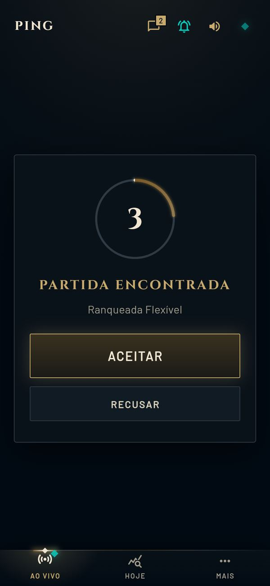
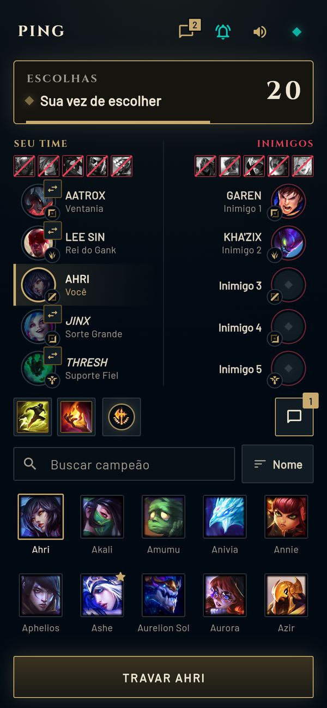
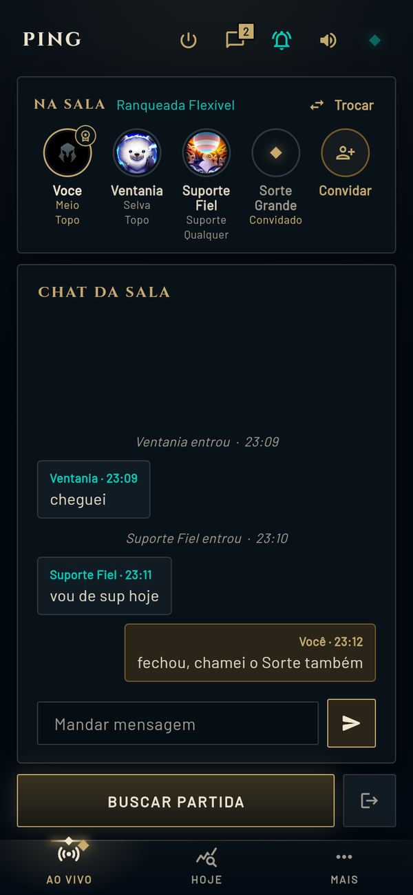
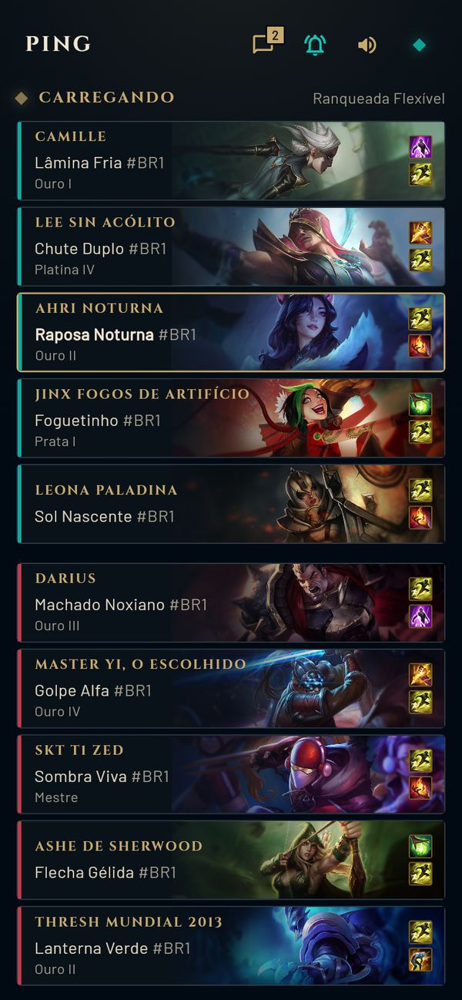
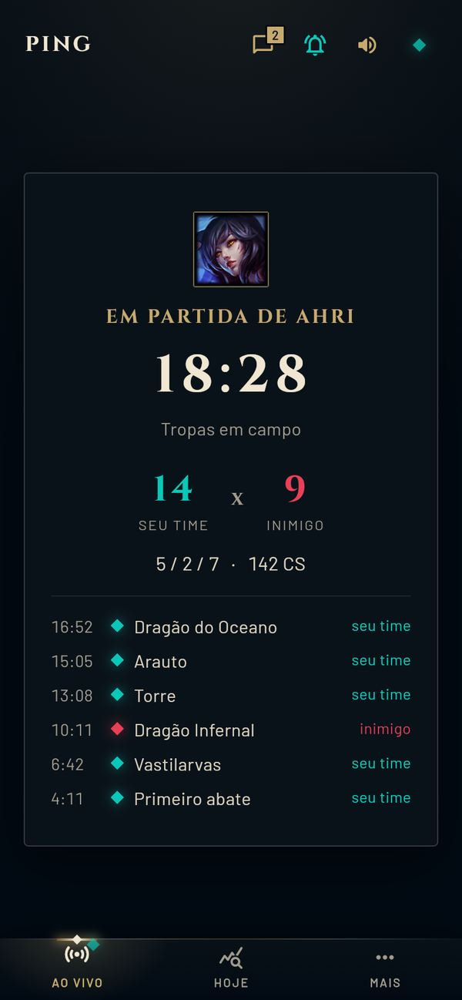
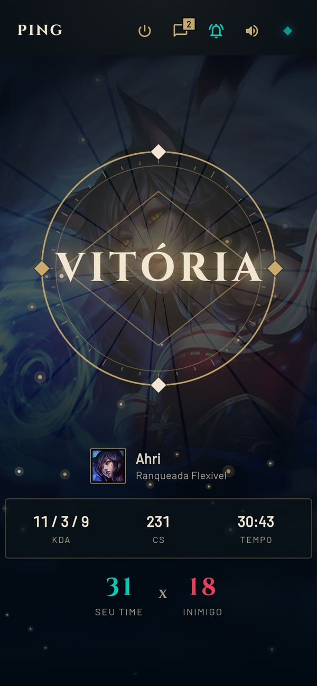
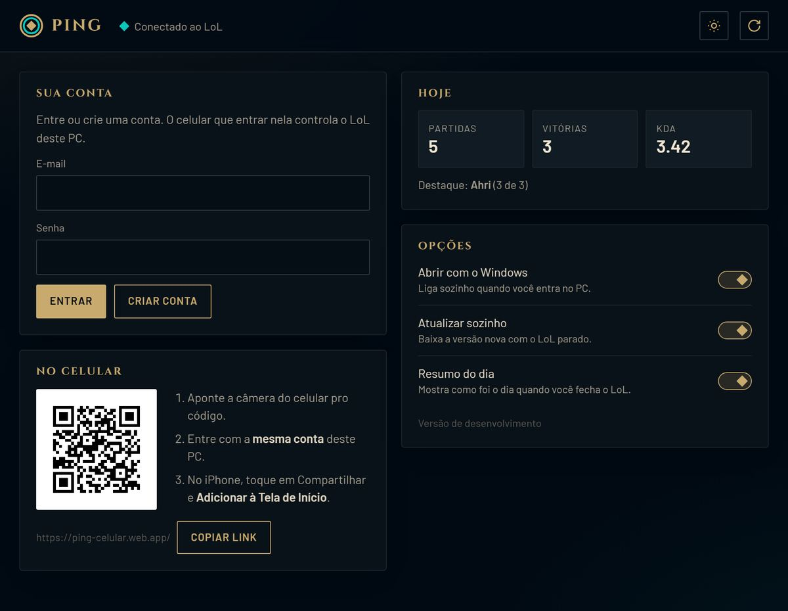

<div align="center">


# Ping

**Controle o League of Legends pelo celular.**

[](https://github.com/ArturoAndreatta/ping/actions/workflows/pc.yml)
[](https://github.com/ArturoAndreatta/ping/actions/workflows/app.yml)
[](https://github.com/ArturoAndreatta/ping/releases/latest)


[](LICENSE)


&nbsp;&nbsp;


### [Baixar o Ping para Windows](https://github.com/ArturoAndreatta/ping/releases/latest/download/PingSetup.exe)

[Instalar](#instalar) · [No celular](#no-celular) · [Privacidade](#o-que-sai-do-seu-computador) · [Perguntas](#perguntas) · [Desenvolver](#desenvolver)

</div>

---

## O que ele faz

Saiu de perto do PC e a fila estourou? O Ping fica na bandeja do Windows, conversa com o client do LoL e espelha tudo no seu celular. De lá você aceita a partida, escolhe o campeão e responde os amigos, como se estivesse na frente do PC. **Nada acontece sem um toque seu.**

Pelo celular:

- **Fila e partida:** buscar partida, ver o tempo na fila, sair da fila, aceitar ou recusar quando a partida aparecer
- **Seleção de campeão:** marcar, travar e banir; trocar campeão, posição e ordem com os aliados; banco e cartas da ARAM: Desordem; Arena
- **Runas, feitiços e skins:** escolher a página, editar ou criar uma, trocar os feitiços e a skin
- **Sala:** criar sala em qualquer modo, convidar amigos, escolher posição e conversar no chat
- **Mensagens:** conversar com os amigos do client
- **Partida em andamento:** tela de carregamento com os dois times, tempo, placar, seu KDA, os objetivos e vitória ou derrota no fim

E mais:

- **Avisos no celular** com o app fechado: partida encontrada, sua vez, pedido de troca, convite, mensagem
- **Hoje** com o resumo das suas partidas do dia
- **Abrir e fechar o LoL** de longe
- **Temas** das regiões de Runeterra
- **Se atualiza sozinho** quando sai versão nova


&nbsp;

&nbsp;

&nbsp;


## Instalar

1. **[Baixe o PingSetup.exe](https://github.com/ArturoAndreatta/ping/releases/latest/download/PingSetup.exe)** e abra. Não precisa ser administrador
2. A janela do Ping abre sozinha. Crie uma conta com e-mail e senha
3. Pronto: o Ping fica na bandeja e abre junto com o Windows

> **Aviso do SmartScreen:** o Windows avisa na primeira vez porque o instalador não tem assinatura digital paga. Clique em **Mais informações** e depois em **Executar assim mesmo**. O código inteiro está neste repositório, e o instalador é gerado pelo [GitHub Actions](.github/workflows/release.yml) a partir dele.

<picture>
  <source media="(prefers-color-scheme: light)" srcset="docs/painel-claro.jpg">
  
</picture>

## No celular

1. Aponte a câmera para o **QR code** da janela do Ping (ou abra [ping-celular.web.app](https://ping-celular.web.app))
2. Entre com a **mesma conta** do PC
3. No iPhone: **Compartilhar** e **Adicionar à Tela de Início**. No Android: **Instalar app** no menu do Chrome. Os avisos com o app fechado só chegam assim

| | App aberto | App fechado |
|---|---|---|
| Ver a fila, a sala e a seleção | Ao vivo | Não |
| Aceitar, escolher, conversar | Sim | Não |
| Avisos (partida, sua vez, mensagem) | Som e vibração | Notificação do celular |

Um celular pode controlar vários PCs na mesma conta, e o mesmo PC mostra a conta do LoL que estiver logada.

## O que sai do seu computador

- **Estado do client:** a fase, a sala, a seleção, a partida, os amigos online e as conversas recentes vão para o Firebase Realtime Database, num lugar que só a sua conta lê. Sem conta conectada, nada fica lá
- **Comandos:** o celular deixa o pedido no mesmo banco, o PC executa e apaga
- **Avisos:** o PC manda só o tipo do aviso e o que aparece nele (ex.: o nome do amigo) para o disparador na Cloudflare, que entrega no seu celular
- **Conta:** e-mail e senha ficam no Firebase Authentication. A senha nunca é guardada no PC
- **Atualização:** consulta os releases deste repositório. Não há telemetria
- **Nunca sai:** senha do LoL, dados de pagamento, arquivos do seu PC

O Ping fala só com a API local do client (a mesma que a tela do client usa) e nunca mexe no jogo em si.

## Perguntas

<details>
<summary><b>Posso tomar ban por usar?</b></summary>

O Ping não joga por você: toda ação vem de um toque seu no celular e usa o mesmo caminho dos botões do client. Ele não lê a memória do jogo, não simula clique e não mexe no jogo em andamento. Mesmo assim, é um programa de terceiros: use por sua conta.
</details>

<details>
<summary><b>Funciona sem o PC ligado?</b></summary>

Não. O celular é o controle remoto: quem fala com o LoL é o PC, com o Ping aberto.
</details>

<details>
<summary><b>Os avisos não chegam no iPhone</b></summary>

Precisa do iOS 16.4 ou mais novo e do app adicionado à Tela de Início pelo Safari. Abra o app pela tela de início e confira **Avisar neste celular** em **Mais**, **Avisos**.
</details>

<details>
<summary><b>É grátis?</b></summary>

Sim, e o código é aberto (MIT).
</details>

<details>
<summary><b>Como desinstalo?</b></summary>

Em Configurações do Windows, Aplicativos, Ping, Desinstalar. Sai o programa, os atalhos e a inicialização com o Windows. A sua conta continua existindo e serve se você instalar de novo.
</details>

<details>
<summary><b>Achei um problema</b></summary>

Abra uma [issue](https://github.com/ArturoAndreatta/ping/issues) contando o que aconteceu. O log fica em `%LOCALAPPDATA%\Ping\ping.log`.
</details>

## Como funciona

1. **O PC lê o client.** O Ping lê a API local do client do LoL e monta o estado: fase, sala, seleção, partida
2. **O estado vai pra nuvem.** Cada mudança é gravada no Firebase, só para a sua conta
3. **O celular mostra.** O app recebe a mudança na hora e desenha a tela parecida com a do client
4. **Você toca, o PC faz.** O toque vira um comando no banco; o PC confere se ainda vale e executa no client pela mesma rota da tela, com um intervalo entre ações seguidas

### Por dentro

- Programa do PC em Python, na bandeja do Windows (pystray), com uma janelinha local para conta, QR e opções
- App do celular em Flutter web, instalável como PWA
- Firebase Realtime Database como ponte e Firebase Authentication para a conta; as regras só deixam a conta que o PC confirmou ler o estado e mandar comandos
- Avisos por Web Push padrão (sem FCM), mandados por um Cloudflare Worker
- Atualização pelos releases do GitHub, com o manifesto assinado (Ed25519)

## Desenvolver

Precisa de [Python 3.10+](https://www.python.org/downloads/) no Windows, [Flutter](https://docs.flutter.dev/get-started/install) para o app e [Node](https://nodejs.org) para o disparador.

```powershell
pip install -r pc/requirements.txt
pythonw pc/ping.pyw

cd app
flutter pub get
flutter run -d chrome
```

O app tem um modo demonstração, sem PC nem Firebase: abra com `?vitrine=<tela>` (ex.: [`?vitrine=pick`](https://ping-celular.web.app/?vitrine=pick)). A lista das telas fica em `app/lib/vitrine.dart`.

| Pasta | O que tem |
|---|---|
| `pc` | Programa do Windows: `ponte.py` espelha o client e executa os comandos, `lcu.py` fala com o client, `painel.py` e `ui/` são a janela, `empacotar.py` gera o instalador |
| `app` | App do celular em Flutter web |
| `disparador` | Cloudflare Worker dos avisos (`npm run teste`) |
| `database.rules.json` | Regras do banco |
| `.github/workflows` | Checagem do PC e do app em todo push, deploy do app e o release que gera o `PingSetup.exe` |

**Hospedar o seu:** crie um projeto no Firebase com Realtime Database e Authentication (e-mail/senha e anônimo), troque o projeto em `pc/servidor.py`, `.firebaserc` e `app/lib/main.dart`, e publique com `firebase deploy --only database,hosting`. Para os avisos, `npm run vapid` no `disparador/`, os segredos `VAPID_PRIVADA` e `FIREBASE_CONTA` com `npx wrangler secret put` e `npx wrangler deploy`. O plano grátis do Firebase aceita 100 conexões ao mesmo tempo (cada PC e cada celular aberto contam uma).

**Publicar versão:** criar e enviar a tag `vX.Y.Z` (`git tag v1.2.0` e `git push origin v1.2.0`). O workflow gera o instalador, testa num Windows limpo, assina o manifesto (secret `PING_ASSINATURA`, chave gerada com `python pc/assinatura.py gerar`) e publica o release.

Sugestões e PRs são bem-vindos.

---

<div align="center">

O Ping não é endossado pela Riot Games e não reflete a visão ou opinião da Riot Games nem de ninguém envolvido oficialmente na produção ou gestão de League of Legends. League of Legends e Riot Games são marcas registradas da Riot Games, Inc.

Feito por [Arturo Andreatta](https://github.com/ArturoAndreatta) · [MIT](LICENSE)

</div>
